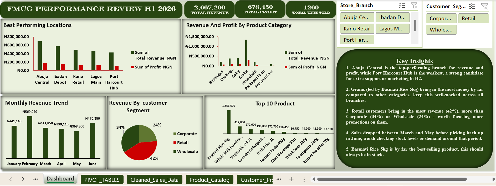

## FMCG Sales Analysis (H1 2026) | Excel

**Business question:** Where should this business focus its energy in the second half of the year?

## Project Overview

This project analyses six months (January to June 2026) of FMCG sales transactions across 5 store branches in Nigeria. The raw data had inconsistent formatting, mixed casing, and scattered values. I cleaned it, enriched it with lookups, and built an interactive Excel dashboard that shows which branches, products, and customer segments drive the business.

## Dashboard Preview

## Tools and Skills Used

- **Microsoft Excel**
- **Data cleaning:** standardising inconsistent entries, fixing mixed casing, and tidying scattered values
- **VLOOKUP:** enriching the sales data with product and customer details
- **PivotTables:** 5 PivotTables to summarise revenue and profit
- **Charts and slicers:** an interactive dashboard filtered by Store Branch and Customer Segment

## Dataset

The workbook has these sheets:

| Sheet | What it contains |
|---|---|
| Dashboard | Final interactive dashboard with KPIs, charts, slicers, and key insights |
| PIVOT_TABLES | The 5 PivotTables behind the dashboard |
| Cleaned_Sales_Data | Sales transactions after cleaning (Transaction ID, Order Date, Month, Customer ID, Customer Name, Gender, Customer Segment, Location State, Product ID, and more) |
| Product_Catalog | Product details used for lookups |
| Customer_Profile | Customer details used for lookups |

## Process

1. **Cleaned the raw data:** standardised inconsistent entries, corrected mixed casing, and fixed scattered values.
2. **Enriched the data:** used VLOOKUP to bring product and customer details into the sales data.
3. **Built 5 PivotTables:** revenue and profit by branch, product category, customer segment, month, and product.
4. **Designed the dashboard:** KPI cards, charts, and slicers so the viewer can filter by branch and customer segment.
5. **Wrote the insights:** turned the numbers into clear business recommendations.

## Key Numbers

| Metric | Value |
|---|---|
| Total Revenue | ₦2,667,200 |
| Total Profit | ₦678,450 |
| Total Units Sold | 1,260 |

## Key Insights

**1. Abuja Central is the star branch.** It has the highest revenue (₦698,960) and profit (₦176,170) of all 5 locations. Port Harcourt Hub has the lowest revenue (₦427,520), so it has the most room to grow.

**2. Grains dominate sales.** Basmati Rice 5kg is the best-selling product by a wide margin and brought in ₦1,351,500, far more than any other product.

**3. Retail customers drive the most revenue (42%).** Wholesale (34%) and Corporate (24%) follow.

**4. Sales dipped from March to May, then recovered strongly in June.**

| Month | Revenue |
|---|---|
| January | ₦441,140 |
| February | ₦569,950 |
| March | ₦411,850 |
| April | ₦399,110 |
| May | ₦368,800 |
| June | ₦476,350 |

## Recommendations for H2 2026

- **Keep Grains well stocked**, especially Basmati Rice 5kg, since it is the main revenue driver.
- **Give Port Harcourt Hub extra support or marketing**, because it is the weakest branch and the best growth opportunity.
- **Investigate the March to May dip**, and plan stock and promotions around that period.
- **Keep focusing on Retail customers**, while looking for ways to grow Corporate sales.

## Files in This Folder

- [FMCG_Sales_Analysis.xlsx](FMCG_Sales_Analysis.xlsx): the full Excel workbook (download to explore the dashboard and slicers)
- [dashboard.png](dashboard.png): dashboard screenshot
- [pivot-tables.png](pivot-tables.png): PivotTables screenshot
- [cleaned-data.png](cleaned-data.png): cleaned dataset screenshot

## How to Explore

1. Download `FMCG_Sales_Analysis.xlsx`.
2. Open it in Excel and go to the **Dashboard** sheet.
3. Click the slicers (Store Branch, Customer Segment) to filter the charts.

## Author

**Anyanwu David Matthew**

Data Analyst | Excel | Data Cleaning | PivotTables

LinkedIn: [Anyanwu David Matthew](https://www.linkedin.com/in/anyanwu-david-matthew-66995942a)
