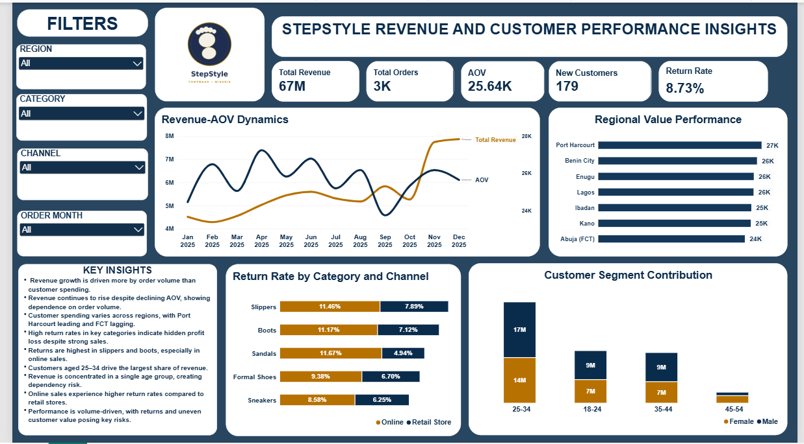

# StepStyle Footwear Sales Performance | Power BI

**Business question:** What is truly driving performance, and where is the business at risk?

## Project Overview

This project is a Power BI dashboard built on a fictional dataset for StepStyle, a footwear business. Instead of only showing numbers, I focused on explaining what is driving revenue, how customers spend, what happens after the sale (returns), and where the business is exposed to risk.

## Dashboard Preview

## Tools and Skills Used

- **Power BI Desktop**
- **DAX measures:** Total Revenue, Total Orders, Average Order Value (AOV), New Customers, and Return Rate
- **Interactive filters:** Region, Category, Channel, and Order Month
- **Data visualisation:** line chart, bar charts, and stacked column charts
- **Business insight writing:** turning charts into clear findings

## What the Dashboard Shows

| Visual | What it answers |
|---|---|
| KPI cards | Total Revenue, Total Orders, AOV, New Customers, Return Rate |
| Revenue-AOV Dynamics | How revenue and average order value move month by month in 2025 |
| Regional Value Performance | Which regions have strong or weak spending per customer |
| Return Rate by Category and Channel | Which products and sales channels have the most returns |
| Customer Segment Contribution | Which age groups and genders contribute the most revenue |
| Key Insights panel | A short written summary of the main findings |

## Key Numbers

| Metric | Value |
|---|---|
| Total Revenue | 67M |
| Total Orders | 3K |
| Average Order Value (AOV) | 25.64K |
| New Customers | 179 |
| Return Rate | 8.73% |

## Key Insights

**1. Revenue growth comes from more orders, not higher spending.** Revenue kept rising even when average order value dropped, so the business relies heavily on order volume. This is risky if demand slows down.

**2. Customer spending differs by region.** Port Harcourt leads in spending per customer, while Abuja (FCT) lags behind.

**3. Return rates are higher than expected.** Returns are highest for slippers and boots, and online sales have higher return rates than retail stores. This points to hidden profit loss despite strong sales.

**4. One age group drives most of the revenue.** Customers aged 25 to 34 contribute the largest share, which creates a dependency risk.

## Recommendations

- **Grow spending per customer**, not just orders, for example through bundles and add-on offers.
- **Reduce returns in slippers and boots**, especially online, by checking product descriptions, sizing guidance, and quality.
- **Support lower-spending regions**, such as Abuja (FCT), with targeted offers.
- **Reach other age groups** (18 to 24, 35 to 44) so revenue depends less on the 25 to 34 group.

## Files in This Folder

- [StepStyle_Sales_Dashboard.pbix](StepStyle_Sales_Dashboard.pbix): the Power BI report file (open it with Power BI Desktop)
- [stepstyle-dashboard.png](stepstyle-dashboard.png): dashboard screenshot

## How to Explore

1. Download `StepStyle_Sales_Dashboard.pbix`.
2. Open it in **Power BI Desktop** (free from Microsoft).
3. Use the filters (Region, Category, Channel, Order Month) to explore the visuals.

## Author

**Anyanwu, Matthew David**

Data Analyst | Excel | Power BI | Data Cleaning

LinkedIn: [linkedin.com/in/matthew-david-anyanwu-66995942a](https://linkedin.com/in/matthew-david-anyanwu-66995942a)
